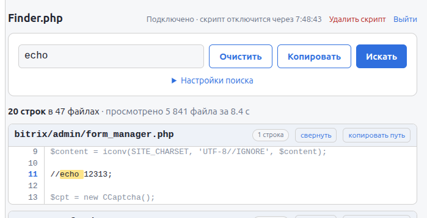

# 🔎 Finder.php

Простой инструмент для поиска текста в исходном коде CMS и самописных сайтов на PHP, размещенных на сервере. Предназначен для веб-мастеров.

<p align="center">
  
</p>

Позволяет запустить процедуру поиска в PHP, JS, CSS и других текстовых файлах, без необходимости скачивать все содержимое сайта на компьютер. Также избавляет от необходимости подключаться по SSH и прописывать команды в терминале. Данный скрипт старается игнорировать директории с кэшем, ищет текст только в файлах по маске расширения, позволяет указать папку для поиска, маски исключения из поиска.

Поддерживает работу в PHP от 5.4 до 8.5.

## 🚀 Запуск

Интерфейс доступен через браузер.

Перед работой, придумайте два личных ключа и запишите их в файле finder.php в константы:

- F2_RUN_KEY - Ключ запуска (от 5 символов).
- F2_TOKEN - Токен доступа к интерфейсу (от 10 символов).

Файл finder.php загрузите в корень сайта, через FTP, SSH или панель хостинга. В браузере введите ссылку к файлу на сайте в виде:
```
 https://*адрес сайта*/finder.php?run=*ключ запуска*
```

После удачного запуска, откроется форма авторизации, введите в нее **токен доступа**.

## 🔎 Поиск

После прохождения авторизации, в форме поиска, введите искомый текст. Нажмите "Искать". Если поиск обнаружит файлы, содержащие искомый текст, отобразятся пути до файлов и отрывок из найденного текста в файле. Обычно поиск не занимает более 30 секунд, максимальное время ожидания ответа - 55 секунд.

## 🔧 Настройки скрипта

В интерфейсе доступны для настройки:

- маска расширений файлов (по умолчанию - `*.{php,js}`)
- папка или файл для поиска (по умолчанию - корень)
- лимит количества результатов (по умолчанию - 200)
- маска исключения папок и файлов
- корень поиска (можно включить поиск по папке выше)
- выключатель регулярных выражений
- выключатель учёта регистра
- выключатель поиска в минифицированных файлах
- выключатель отображения даты изменения файла

В случаях, когда папка с файлами проекта находится за пределами папки Document Root, например в Laravel файлы проекта выше папки "public", можно указать в поле "Корень поиска" значение "На уровень выше".

## 🛡️ Защиты от запуска посторонними лицами

Скрипт необходимо удалять с сайта сразу, как только завершите процедуру поиска. При достаточных правах для PHP, скрипт можно удалить прямо из страницы в браузере.

Если скрипт размещен на сервере более 8 часов назад, скрипт перестанет запускаться из браузера. Для продолжение поиска, необходимо будет загрузить скрипт на сервер заново. 

Чувствительные данные (пароли, токены) заменяются символами `***`, во избежание кражи.
